<picture>
  <source media="(prefers-color-scheme: dark)" srcset="assets/banner-dark.svg">
  
</picture>

  
  
  

Most of what I build starts as "I wish this existed": mobile apps in **Flutter**, web and desktop
apps in **TypeScript**, and lately a game engine in **Rust**, straight on the GPU. My apps go out on
Google Play under the name **Mavy**.

📍 South Africa · 🌐 More about me and what I build on my website:
**[shawndupreez.dev](https://www.shawndupreez.dev)**

##  Mavy: simple apps and games

The first releases are on their way to Google Play.

<table>
  <tr>
    <td width="50%" valign="top">
      <h3>⏱️ One Minute</h3>
      Six small daily puzzles, a 60-second arcade and daily rankings. Everyone gets the same
      puzzles each day, generated from a seed.  
      <code>Flutter</code> <code>Firebase</code> · <a href="https://one-minute-bf5f0.web.app">website</a>
    </td>
    <td width="50%" valign="top">
      <h3>🎨 Hue Hunt</h3>
      A holiday game: each player gets their own Color of the Day, hunts down three things in it,
      and the trip turns into a rainbow photo diary. Works offline and syncs when there's signal.  
      <code>Flutter</code> <code>Supabase</code>
    </td>
  </tr>
  <tr>
    <td colspan="2" valign="top">
      <h3>🎾 LePadêl</h3>
      Padel americano tournaments with friends: draws, live scores and rankings, with scoring from
      your wrist on Wear OS and Garmin watches. Built with a friend.  
      <code>Flutter</code> <code>Supabase</code> <code>Kotlin</code> <code>Monkey C</code>
    </td>
  </tr>
</table>

## 🎮 Games

<table>
  <tr>
    <td width="50%" valign="top">
      <h3>⛏️ Blocklore</h3>
      An original voxel survival sandbox on my own renderer. Every texture, creature, the font and
      every sound is generated in code, with no asset files. Host your world for friends over LAN
      or an invite code.  
      <code>Rust</code> <code>wgpu</code> <code>winit</code>
    </td>
    <td width="50%" valign="top">
      <h3>🕹️ The Arcade</h3>
      Six original browser games with accounts and leaderboards, living on my website.  
      <code>React</code> <code>Canvas</code> <code>Supabase</code> ·
      <a href="https://www.shawndupreez.dev/arcade">play now</a>
    </td>
  </tr>
  <tr>
    <td width="50%" valign="top">
      <h3>📚 Whisperwood Library</h3>
      A cosy first-person 3D library: your own e-books fly onto genre shelves, and you can take one
      down and read it.  
      <code>three.js</code> <code>IndexedDB</code>
    </td>
    <td width="50%" valign="top">
      <h3>📖 Bible Book Scramble</h3>
      A pass-the-phone party game where teams race to unscramble the names of the books of the
      Bible.  
      <code>Flutter</code>
    </td>
  </tr>
</table>

## 🧩 Apps and tools

| Project | What it does | Built with |
| --- | --- | --- |
| **Floorcraft** | A floor planner in the browser: draw in 2D, walk through it in 3D, and let an AI assistant suggest changes you approve first. | React · three.js · MCP |
| **Cartwise** | Finds where your whole shopping list is cheapest across South African stores near you, with a meal planner and recipes that turn into priced lists. | React · Node.js · Capacitor · Ollama |
| **Randwise** | Budgeting in Rand: bank SMS notifications become transactions automatically, and bills never surprise you. | React · Node.js · Capacitor |
| **Armoire** | A wardrobe on your phone: photograph your clothes, have them tagged, and plan outfits around the weather. No account needed. | Flutter · Ollama · ComfyUI |
| **Local model chat** | A desktop chat app for local models that checks your hardware and recommends models that will actually fit. | Electron · React · Ollama |
| **Offline budgeting** | Two takes on private budgeting: envelope budgets on the phone, and a desktop app that imports bank exports. | Flutter · Drift · Electron · llama.cpp |
| **Statement scanner** | Reads PDF bank statements with a vision-language model running on the phone itself. *Prototype.* | Flutter · Kotlin · ONNX Runtime |
| **Study Helper** | Add your study material, let the AI research around it, then talk it through with a character that answers out loud. *Prototype.* | Node.js · Gemini · Piper TTS |
| **Project boards** | Boards in table, Kanban and timeline views that stay in sync between users. *Prototype.* | Vue 3 · Vuetify · Supabase |
| **Local media player** | Plays home libraries in formats the browser engine can't, such as HEVC, by transcoding on the fly. | Node.js · ffmpeg · NW.js |
| **Instant replay** | Records the screen in the background and saves the last few seconds when you press a hotkey. *Prototype.* | Electron · ffmpeg |
| **QR stamp card** | A digital loyalty card: staff show a QR code that changes every 30 seconds, and customers scan it to collect stamps. *Prototype.* | React Native · Supabase |
| **The Council** | A UI prototype for an anonymous opinions app with swipeable cards, comments and a leaderboard. | React Native · Tailwind |

## 🐧 Tinkering

- **My desktop**: I daily-drive [Omarchy](https://omarchy.org) (Arch + Hyprland), write my own bar
  and Control Panel tweaks, and keep my setup in sync with a small homemade dotsync tool.
- **TV Hub**: a new home screen for an old Samsung smart TV, served and kept up to date by a small
  Node server. *Prototype.*
- **Boot menu themes**: a Python script that draws a retro boot menu for a multi-boot USB stick at
  15 screen resolutions.
- **Neon desktop**: a Windows theme with an audio visualiser, an animated background and a glass dock.

## 🧰 Stack

<table>
  <tr>
    <td><b>Languages</b></td>
    <td>
      <picture>
        <source media="(prefers-color-scheme: dark)" srcset="https://skillicons.dev/icons?i=dart%2Ckotlin%2Crust%2Cts%2Cjs%2Cpy%2Ccs%2Cbash&theme=dark">
        
      </picture>
    </td>
  </tr>
  <tr>
    <td><b>Apps and UI</b></td>
    <td>
      <picture>
        <source media="(prefers-color-scheme: dark)" srcset="https://skillicons.dev/icons?i=flutter%2Candroidstudio%2Creact%2Cnextjs%2Cvue%2Ctailwind%2Cvite%2Cthreejs%2Celectron&theme=dark">
        
      </picture>
    </td>
  </tr>
  <tr>
    <td><b>Back end and data</b></td>
    <td>
      <picture>
        <source media="(prefers-color-scheme: dark)" srcset="https://skillicons.dev/icons?i=nodejs%2Cexpress%2Cfastapi%2Cdotnet%2Cpostgres%2Csqlite%2Csupabase%2Cfirebase&theme=dark">
        
      </picture>
    </td>
  </tr>
  <tr>
    <td><b>Platform and tools</b></td>
    <td>
      <picture>
        <source media="(prefers-color-scheme: dark)" srcset="https://skillicons.dev/icons?i=docker%2Ckubernetes%2Cnginx%2Cgithubactions%2Cazure%2Clinux%2Carch%2Cgit%2Cvitest&theme=dark">
        
      </picture>
    </td>
  </tr>
  <tr>
    <td><b>AI and graphics</b></td>
    <td>
      
      
      
      
      
      
      
      
      
      
    </td>
  </tr>
</table>

<b>🎓 Earlier: coursework from my BSc in Computer Science &amp; IT</b>

 

- **Proofly**: a receipt scanner for teams with on-device OCR and spending dashboards (Kotlin, Jetpack Compose, ML Kit).
- **[TrailGuide](https://github.com/ShawnDuPreez/TrailGuide)**: an Android hiking companion with
  offline maps, GPS and elevation tracking (Kotlin, team project).
- **SkillSync**: a personal development tracker with dashboards and progress reports (React Native).
- **EventEase**: venue booking on Azure with image uploads and double-booking checks (ASP.NET Core).
- **Budget tracker for Android**: budget goals, categories and receipt photos, stored offline with Room.
- **Monthly claims system**: lecturers submit claims and managers approve them (ASP.NET Core).
- **DevSecOps pipeline**: builds, tests and security scans on every push (GitHub Actions, CircleCI, SonarCloud).
- **Farming and energy marketplace**: a requirements-first prototype designed in UML.
- **Machine learning in cybersecurity**: a literature review on threat and anomaly detection.

